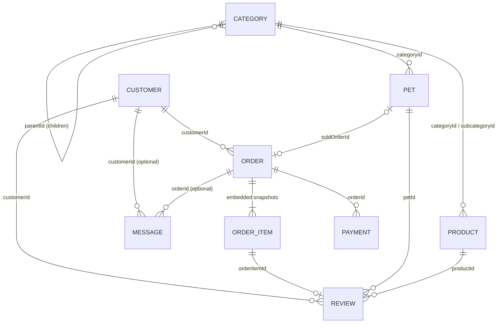

# PetBlitz – Database Architecture

Database: MongoDB Atlas, db `PetBlitz`. ODM: Mongoose 8. Validation: Zod. All money = **integer minor units (INR paise, precision 2)**; prices are tax-exclusive, tax is added per line from `taxRateBps`.

## Collections
| Collection | Purpose |
|---|---|
| categories | Fully dynamic hierarchy (admin-managed; no names in code) |
| pets | Individual animals (dog/cat only) |
| products | Quantity-based accessories (no pet food in Phase 1) |
| customers | Google-OAuth customers, addresses |
| orders | Central record, embedded immutable item/address snapshots |
| payments | Razorpay / wallet payments + refund entries, webhook idempotency |
| reviews | Verified-purchase reviews with moderation |
| messages | Support tickets (bounded thread, max 200) |
| wallet_transactions *(support)* | Append-only wallet ledger; `customers.walletBalance` is the running balance |
| counters *(support)* | Atomic sequences for order/ticket/pet/payment numbers (Mongo has no auto-increment) |

No `admin_users` collection yet: admin auth is a placeholder (`ADMIN_API_KEY`, `src/lib/auth/guards.ts`). Add it when the Admin Portal is built.

## Relationships

## Category rules
* `parentId` = source of truth; `path` (ancestor ids, root first) and `level` (root = 1) are derived and rewritten for the whole subtree on move. `rebuildCategoryHierarchy()` recomputes them from `parentId` (recovery).
* Max depth = `CATEGORY_MAX_DEPTH` (default 3). Names are free text; `type` (dog|cat|accessory) is only a classification. Children inherit the parent's type.
* Slugs are globally unique; renames push the old slug into `slugHistory` so old URLs resolve (`getCategoryBySlug` → `redirected`).
* `isActive` = operational, `isVisible` = public navigation, `archivedAt` = archived. **Flags are not cascaded.** A category is public only if it and every ancestor are active, visible and unarchived (hiding a parent hides the subtree; un-hiding restores it).
* Archive needs `archiveDescendants` if active children exist, and `reassignDependentsTo` if pets/products are assigned. Nothing cascades or deletes.
* Hard delete only if: no children, no pets/products, never in an order snapshot (retention policy).
* Moves: descendants updated first, moved node last, in a transaction when supported (Atlas does).
* New categories need **no code change** (`createCategory`). Seed data lives only in `scripts/data/initial-categories.ts`, never imported by the app.

## Integrity mechanisms
* **Pets**: `reservePet` is one atomic `findOneAndUpdate`; `markPetSold` only moves reserved-by-this-order → sold. No double sale.
* **Products**: `reserveStock` checks `stock − reserved ≥ qty` and increments in one atomic update (no oversell).
* **Order items** carry `inventoryState` (`reserved → committed | released`), claimed atomically per item, so cancel/webhook retries are idempotent.
* **Order creation** has no transaction (reservations are single-document atomics); on failure all reservations are compensated, and `scripts/release-expired.ts` sweeps leftovers.
* **Idempotency**: unique `{customerId, idempotencyKey}`. Order numbers `PB-<year>-<seq>` from `counters`.
* **Payments**: signature verified on the raw body; event id deduped atomically with the state change; amount/currency checked against payment and order; `failed` can only overwrite `pending`; refunds validated cumulatively in one atomic update.
* **Reviews**: eligibility and `verifiedPurchase` are server-derived; unique `{orderItemId, customerId}`; rating summary `{count,sum}` updated via `$inc` from the observed status transition (`recomputeRatingSummary` for recovery).
* **Messages**: `messageCount < 200` guard on append; customers see only their own tickets.

## Indexes
Declared on schemas; `autoIndex` is off at runtime; `npm run db:indexes` checks duplicates first, skips conflicting collections, never drops.
Unique: `categories.slug`, `categories.seedKey`(partial), `pets.slug|petCode|microchipId`(partial), `products.slug|sku`, `customers.googleId|email`, `orders.orderNumber`, `orders{customerId,idempotencyKey}`, `payments.paymentRef|providerPaymentIntentId|providerCheckoutSessionId`(partial), `reviews{orderItemId,customerId}`, `messages.ticketNumber`.
Query indexes: category `{parentId,sortOrder}`, `{path}`, `{isActive,isVisible,archivedAt}`; pet/product public listing compounds; orders by customer/status/payment; `items.category.categoryId` (delete safety); review per-target; message inbox.

## Public vs private data
Pets: explicit field allowlist (no internal health notes, microchip, documents, vaccination records, reservation, audit fields). Products expose `stockStatus`, not quantities. Customer order views omit `adminNote`, `idempotencyKey`, actor ids.

## Customer deletion
`anonymizeCustomer` scrubs PII and keeps the document; orders keep their own snapshots (legal/tax retention).

## Limitations / next steps
1. Admin auth is a bearer-key placeholder → real admin auth + RBAC.
2. Customer session layer (Google token verification / Auth.js) not built; services take `customerId` and enforce ownership.
3. Rate limiter is in-memory per instance → shared store in production.
4. Admin write routes and customer routes (checkout, reviews, tickets, contact form) are service-ready but not exposed over HTTP yet.
5. Razorpay calls are gated on `RAZORPAY_KEY_ID/SECRET`; wallet top-up (adding money via Razorpay) is not built yet (admin credit exists).
6. No customer review editing; no `$jsonSchema` collection validators (Mongoose + Zod validate).
7. Tax model is simple (per-item rate, tax-exclusive); confirm GST treatment with an accountant.

## Razorpay payments
Flow: `createRazorpayOrder` (amount from the DB order) → browser opens Razorpay Checkout → `confirmRazorpayCheckout` (HMAC of `order_id|payment_id`, then the payment is re-fetched from Razorpay and amount/currency checked) and/or webhook `POST /api/webhooks/razorpay` (HMAC of the RAW body with `RAZORPAY_WEBHOOK_SECRET`, dedupe by `x-razorpay-event-id`). Both paths converge on one idempotent handler. Subscribe the webhook to: `payment.captured`, `order.paid`, `payment.failed`, `refund.processed`, `refund.failed`. Keep Razorpay **auto-capture** on (the service captures `authorized` payments as a fallback).

## Wallet
* `customers.walletBalance` (paise, never negative) is shown in the profile (`wallet: {balance, currency}`) and cannot be set by any customer input schema.
* Every change = one ledger row (`wallet_transactions`) with a UNIQUE `idempotencyKey` → duplicate webhooks/retries cannot double-credit. Row + balance change are one transaction on Atlas; debits are guarded (`balance >= amount`) so concurrent spends cannot overdraw. `reconcileWallet()` compares balance vs ledger.
* **Refunds** (`refundPayment`): default destination = **wallet** (instant). The amount is first reserved atomically (cumulative check), then credited with key `refund:<refundId>`; if the credit fails the reservation is released. `destination: "original"` refunds via Razorpay and is finalised by the `refund.processed` / `refund.failed` webhooks (failure releases the reserved amount). Wallet-paid orders can only refund to the wallet.
* **Cancel a paid order** (`cancelOrderWithRefund`): cancels, releases/restocks inventory and refunds the full remaining amount to the wallet, safely repeatable. A payment captured *after* cancellation is auto-refunded to the wallet.
* **Pay with wallet** (`payOrderWithWallet`): full-amount only (no split wallet + card yet); on failure the debit is reversed.
* Admin: `adminAdjustWallet` (credit/debit with reason, ledgered).

## Admin/customer/payments update (Phases 2–4)
* **payments** now has `purpose` (`order` | `wallet_topup`); `orderId` is optional for top-ups. `provider` is `razorpay` | `wallet`. Refund entries carry a stable `refundId`.
* **orders.paidPaymentId** records the single payment that settled the order. Any other successful payment (wallet + Razorpay on the same order, payment after cancellation) is refunded to the wallet.
* **Refund state changes are atomic:** reserve (cumulative check) → settle. `failRefund` marks the entry failed **and** releases the amount in ONE pipeline update; unmatched refund webhooks no longer consume the event; dashboard-issued refunds are recorded idempotently; `reconcilePendingWalletRefunds` finishes crashed wallet refunds.
* **Race fixes:** `markOrderPaid` re-checks for a concurrent cancellation after committing inventory and undoes it; stock adjustments cannot go below zero or below reserved quantity; wallet debits are guarded atomically.
* No index specs changed (existing Atlas indexes stay compatible).
* See `docs/API.md` (endpoints) and `docs/OPERATIONS.md` (ops/security).

## v3 additions (admin accounts, store config, cart, coupons, GST, returns, e-mail)
New collections (all created by `npm run db:indexes`; nothing is dropped): `admin_users` (scrypt hash, role, encrypted TOTP secret, lockout counters), `admin_sessions` (token **hash** only, TTL-expired), `admin_audit_logs` (append-only; no bodies), `store_settings` (singleton `main`: shipping rules, GST mode + seller details, return policy), `carts` (one per customer, 90-day TTL), `coupons`, `coupon_redemptions` (unique per order = idempotent release), `email_outbox` (deduped by event key, retried, sent rows purged after 90 days), `invoices` (one per order, sequential per Indian financial year), `return_requests`, `inventory_movements`.
Changed: `orders` gained `couponCode`, `couponDiscount`, `pricesIncludeTax`, `placeOfSupply`, item `hsnCode`; `pets`/`products` gained `hsnCode` and a weighted **text index** (public search; falls back to regex if the index is missing); `payments` gained `purpose`/claim-lease fields (from the Razorpay order-claim work).
Pricing: all paise integers. Tax is computed after discounts and the coupon share; prices may be tax-**inclusive** (set in Settings) or exclusive. CGST+SGST vs IGST is decided by seller state vs the shipping address state (GST state codes in `lib/gst.ts`).
